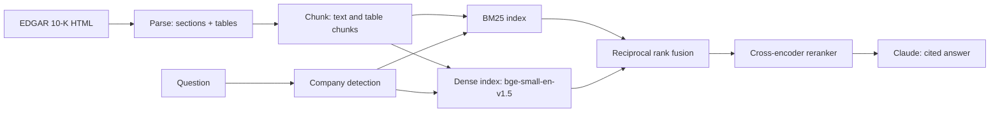

# financial-rag-eval


Retrieval-augmented question answering over the FY2025 10-K filings of five large US banks (JPM, BAC, MS, GS, C), with a reproducible retrieval evaluation that compares five configurations.

## Why this exists
Financial filings are long, repetitive across companies, and full of tables. A plain vector search often returns a plausible passage from the wrong section or the wrong bank. This repo measures where retrieval fails and what each component buys.

## Architecture


## Results (34 questions, retrieval only)
| Config | Hit@1 | Hit@5 | MRR@5 | Avg latency |
|---|---|---|---|---|
| dense only | 0.50 | 0.82 | 0.62 | 23 ms |
| BM25 only | 0.29 | 0.76 | 0.47 | 37 ms |
| hybrid (RRF) | 0.56 | 0.82 | 0.66 | 68 ms |
| hybrid, no company filter | 0.53 | 0.76 | 0.61 | 52 ms |
| hybrid + reranker | 0.65 | 0.97 | 0.77 | 1,392 ms |

Latency is the average retrieval time per question on a laptop CPU.

**Findings**
- The cross-encoder reranker gives the largest gain: Hit@5 rises from 0.82 to 0.97 at about 20x the latency.
- BM25 alone is the weakest, because filings reuse the same terms across sections.
- Hybrid fusion improves Hit@1 slightly over dense search, but Hit@5 is equal. The gap is within noise at this sample size.
- The company filter matters: removing it drops hybrid Hit@5 from 0.82 to 0.76, because other banks' chunks crowd out the right one.

## How the eval works
Each question in `eval/questions.jsonl` has an exact evidence phrase copied from the filing. A retrieval counts as a hit if a returned chunk contains that phrase. Questions cover numeric facts, narrative passages, table rows, and cross-company cases for all five banks.

**Eval correction:** the first run scored the reranker at Hit@5 0.94. Error analysis showed that for one question the reranker returned a regulatory capital table with the same figures, while my eval required a prose sentence. I added optional alternative evidence per question (`alt`) and re-scored all configurations on the same corrected set. One miss remains (`bac-min`); I have not yet diagnosed its cause.

## Agent (LangGraph)
A small analyst agent on top of the retriever. Flow: `guard` → `retrieve` → `draft` → `verify` → `approve`.

- **Guard:** refuses investment-advice questions before any retrieval or model call.
- **Retrieve:** the same hybrid retrieval + reranker as the evaluation, with company detection.
- **Draft:** Claude answers with citations and must call a calculator tool for any arithmetic. The calculator evaluates only numbers and `+ - * / **` (no code execution, exponent capped).
- **Verify:** every number in the draft must appear in the retrieved sources or match a calculator result. Unsupported numbers trigger one retry with feedback; if they persist, the answer is flagged `unverified`.
- **Approve:** human approval gate (CLI) before the answer is final.
- **Trace:** each step is appended to `data/agent_trace.jsonl`.

```bash
uv run python -m agent.graph "By how many dollars did Morgan Stanley's net revenues grow in 2025?"
```

Tests (`uv run pytest`) cover the calculator, the verifier, refusal, retry, flagged answers, and human rejection, with the model mocked so they run without an API key.

**Agent limitations:** verification checks that numbers appear in the sources, not that the claim around them is correct, and it can flag harmless numbers. There is no multi-turn memory, and answer quality depends on the model and on retrieval.

## Limitations
- The eval measures retrieval only, not answer faithfulness.
- 34 questions is a small sample, and one question is about 3 points.
- Evidence matching is phrase-based and can reject valid answers.
- Tables are flattened to text, so numeric questions over tables are not reliable yet.
- Answers cite their sources, but citations are not automatically verified.

## Tradeoffs
- **Reranker:** better accuracy for about 20x latency. I would use it when answer quality matters more than speed, or run it only on the top candidates.
- **Small local models:** `bge-small-en-v1.5` embeddings and a MiniLM cross-encoder run on a laptop CPU with no GPU, at some cost in accuracy.
- **Section-based chunking:** keeps tables intact and tags each chunk with its heading, but some section labels are too broad (for example "Part I").

## Run it
```bash
git clone https://github.com/VarshithaChappidi/financial-rag-eval.git && cd financial-rag-eval
uv sync
# set your name and email in the User-Agent in src/rag/download.py (SEC requires it)
export PYTHONPATH=src
uv run python src/rag/download.py && uv run python src/rag/ingest.py
uv run python src/rag/chunk.py && uv run python src/rag/index.py
uv run python eval/run_eval.py
```
For generated answers, put `ANTHROPIC_API_KEY=...` in a `.env` file, then:
```bash
uv run python -m rag.generate "What was Goldman Sachs CET1 capital ratio?"
```

## Next
- Numeric tool for table questions
- Answer faithfulness evaluation
- Eval-gated CI